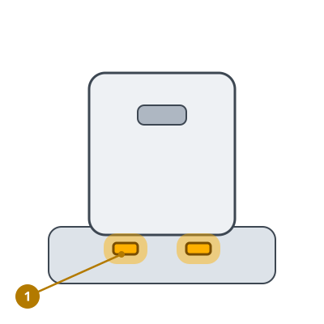
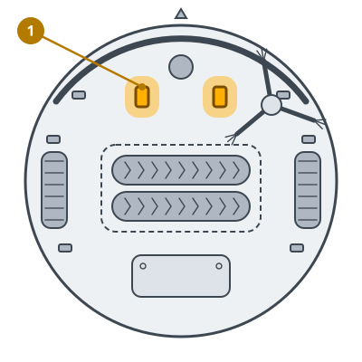
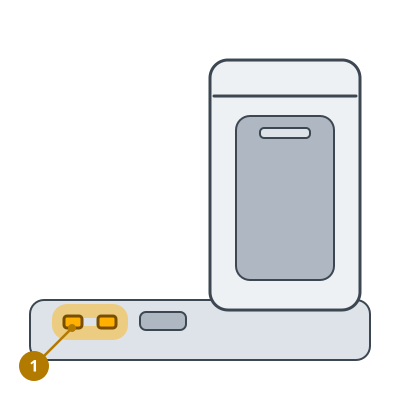
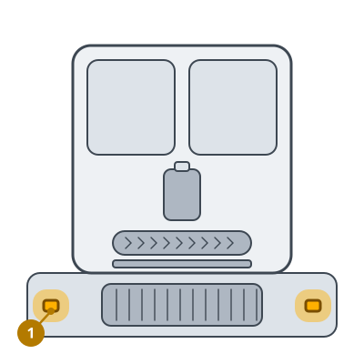
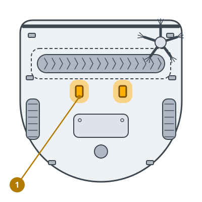
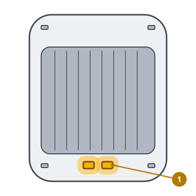

<!-- Generated by scripts/build_care_docs.py from custom_components/roomba_plus/care/. Do not edit: change the texts or drawings there and run the script. -->

# Ladekontakte reinigen

[Alle Pflegeanleitungen](README.md)

## Roomba 600er und 700er · Roomba 800er und 900er

**Wozu**

Die Ladekontakte an Roboter und Station leiten den Ladestrom. Ein Belag darauf unterbricht das Laden.

**So geht's**

1. Den Roboter von der Station nehmen.
2. Die Ladekontakte des Roboters mit einem leicht feuchten Schmutzradierer oder Tuch blank reiben.
3. Die Home Base 60 Sekunden vom Strom trennen und ihre Kontakte genauso reinigen. Das Fenster ihres Andocksensors nur mit einem trockenen Tuch abwischen.
4. Die Home Base wieder einstecken und den Roboter daraufsetzen.

> **Achtung** Nichts Scheuerndes und kein Metallwerkzeug. Grüne, kupferfarbene oder eingesunkene Kontakte sind beschädigt: an den iRobot-Kundendienst wenden.

## Home Base: Roomba e, i und j, Combo j · Prime-Roboter und andere Modelle

**Wozu**

Die Ladekontakte an Roboter und Station leiten den Ladestrom. Ein Belag darauf unterbricht das Laden.

**So geht's**

1. Den Roboter von der Station nehmen.
2. Die Ladekontakte des Roboters mit einem leicht feuchten Schmutzradierer oder Tuch blank reiben.
3. Die Home Base 60 Sekunden vom Strom trennen und ihre Kontakte genauso reinigen. Das Fenster ihres Andocksensors nur mit einem trockenen Tuch abwischen.
4. Die Home Base wieder einstecken und den Roboter daraufsetzen.

> **Achtung** Nichts Scheuerndes und kein Metallwerkzeug. Grüne, kupferfarbene oder eingesunkene Kontakte sind beschädigt: an den iRobot-Kundendienst wenden.

## Clean Base: Roomba e, i und j, Combo j · Prime-Roboter und andere Modelle

**Wozu**

Die Ladekontakte an Roboter und Station leiten den Ladestrom. Ein Belag darauf unterbricht das Laden.

**So geht's**

1. Den Roboter von der Clean Base nehmen.
2. Die Ladekontakte des Roboters mit einem leicht feuchten Schmutzradierer oder Tuch blank reiben.
3. Die Clean Base 60 Sekunden vom Strom trennen und die Kontakte auf ihrer Rampe genauso reinigen.
4. Die Clean Base wieder einstecken und den Roboter daraufsetzen.

> **Achtung** Nichts Scheuerndes und kein Metallwerkzeug. Grüne, kupferfarbene oder eingesunkene Kontakte sind beschädigt: an den iRobot-Kundendienst wenden.

## Wasch-Dock: Roomba e, i und j, Combo j · Prime-Roboter und andere Modelle

**Wozu**

Die Ladekontakte an Roboter und Station leiten den Ladestrom. Ein Belag darauf unterbricht das Laden.

**So geht's**

1. Den Roboter von der Station nehmen.
2. Die Ladekontakte des Roboters mit einem leicht feuchten Schmutzradierer oder Tuch blank reiben.
3. Die Station 60 Sekunden vom Strom trennen. Ihre Kontakte, das Infrarotfenster und die Andockmarke nur mit einem trockenen Tuch abwischen.
4. Die Station wieder einstecken und den Roboter daraufsetzen.

> **Achtung** Nichts Scheuerndes und kein Metallwerkzeug. Grüne, kupferfarbene oder eingesunkene Kontakte sind beschädigt: an den iRobot-Kundendienst wenden.

## Home Base: Roomba s

**Wozu**

Die Ladekontakte an Roboter und Station leiten den Ladestrom. Ein Belag darauf unterbricht das Laden.

**So geht's**

1. Den Roboter von der Station nehmen.
2. Die Ladekontakte des Roboters mit einem leicht feuchten Schmutzradierer oder Tuch blank reiben.
3. Die Home Base 60 Sekunden vom Strom trennen und ihre Kontakte genauso reinigen. Das Fenster ihres Andocksensors nur mit einem trockenen Tuch abwischen.
4. Die Home Base wieder einstecken und den Roboter daraufsetzen.

> **Achtung** Nichts Scheuerndes und kein Metallwerkzeug. Grüne, kupferfarbene oder eingesunkene Kontakte sind beschädigt: an den iRobot-Kundendienst wenden.

## Clean Base: Roomba s

**Wozu**

Die Ladekontakte an Roboter und Station leiten den Ladestrom. Ein Belag darauf unterbricht das Laden.

**So geht's**

1. Den Roboter von der Clean Base nehmen.
2. Die Ladekontakte des Roboters mit einem leicht feuchten Schmutzradierer oder Tuch blank reiben.
3. Die Clean Base 60 Sekunden vom Strom trennen und die Kontakte auf ihrer Rampe genauso reinigen.
4. Die Clean Base wieder einstecken und den Roboter daraufsetzen.

> **Achtung** Nichts Scheuerndes und kein Metallwerkzeug. Grüne, kupferfarbene oder eingesunkene Kontakte sind beschädigt: an den iRobot-Kundendienst wenden.

## Braava jet

**Wozu**

Die Ladekontakte an Roboter und Station leiten den Ladestrom. Ein Belag darauf unterbricht das Laden.

**So geht's**

1. Den Roboter von der Station nehmen.
2. Die Ladekontakte des Roboters mit einem leicht feuchten Schmutzradierer oder Tuch blank reiben.
3. Die Home Base 60 Sekunden vom Strom trennen und ihre Kontakte genauso reinigen. Das Fenster ihres Andocksensors nur mit einem trockenen Tuch abwischen.
4. Die Home Base wieder einstecken und den Roboter daraufsetzen.

> **Achtung** Nichts Scheuerndes und kein Metallwerkzeug. Grüne, kupferfarbene oder eingesunkene Kontakte sind beschädigt: an den iRobot-Kundendienst wenden.
