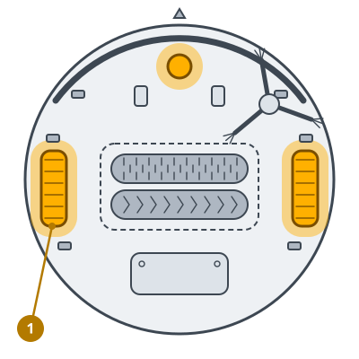
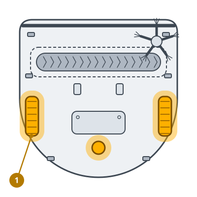

<!-- Generated by scripts/build_care_docs.py from custom_components/roomba_plus/care/. Do not edit: change the texts or drawings there and run the script. -->

# Räder reinigen

[Alle Pflegeanleitungen](README.md)

## Roomba 600er und 700er · Roomba 800er und 900er

**Wozu**

Vorderrad und Antriebsräder tragen den Roboter. Haare oder Sand darin lassen ihn zur Seite ziehen oder stehen bleiben.

**So geht's**

1. Den Roboter umdrehen.
2. Das Vorderrad aus seiner Aufnahme ziehen und das Rad von der Achse nehmen.
3. Haare und Schmutz von Rad, Achse und Aufnahme entfernen.
4. Die Antriebsräder von Hand drehen und alles entfernen, was hakt; dann das Vorderrad wieder einsetzen, bis es einrastet.

> **Achtung** Die Antriebsräder nicht herausziehen: Sie sind nicht zum Ausbauen gedacht.

## Roomba e, i und j, Combo j · Prime-Roboter und andere Modelle

**Wozu**

Vorderrad und Antriebsräder tragen den Roboter. Haare oder Sand darin lassen ihn zur Seite ziehen oder stehen bleiben.

**So geht's**

1. Den Roboter umdrehen.
2. Das Vorderrad aus seiner Aufnahme ziehen und das Rad von der Achse nehmen.
3. Haare und Schmutz von Rad, Achse und Aufnahme entfernen.
4. Die Antriebsräder von Hand drehen und alles entfernen, was hakt; dann das Vorderrad wieder einsetzen, bis es einrastet.

> **Achtung** Die Antriebsräder nicht herausziehen: Sie sind nicht zum Ausbauen gedacht.

## Roomba s

**Wozu**

Das hintere Laufrad und die Antriebsräder tragen den Roboter. Haare oder Sand darin lassen ihn seitlich ziehen oder stehen bleiben.

**So geht's**

1. Den Roboter umdrehen.
2. Das hintere Laufrad aus seiner Halterung ziehen und das Rad von der Achse nehmen.
3. Haare und Schmutz von Rad, Achse und Halterung entfernen.
4. Die Antriebsräder von Hand drehen und entfernen, was hängen bleibt, dann das Laufrad wieder eindrücken, bis es einrastet.

> **Achtung** Die Antriebsräder nicht herausziehen: Sie sind nicht zum Ausbauen gedacht.
