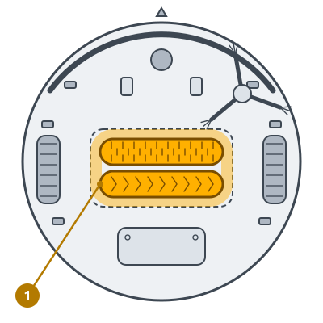
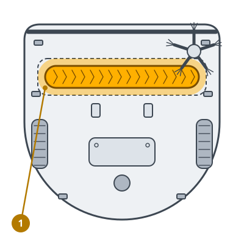

<!-- Generated by scripts/build_care_docs.py from custom_components/roomba_plus/care/. Do not edit: change the texts or drawings there and run the script. -->

# Replace the main brushes

[All care guides](README.md)

## Roomba 600 and 700 series

**What it does**

Worn brushes reach the floor less well and pick up less dirt.

**How to**

1. Turn the robot over and lift the two yellow tabs of the brush frame.
2. Take out the bristle brush and the beater brush. Keep the end caps if the new brushes have none.
3. Put in the new brushes where their shape fits and close the frame.
4. Report the brushes as replaced.

> **Note** The two brushes are not alike and fit only one way round. Do not force them.

## Roomba 800 and 900 series

**What it does**

Worn brushes reach the floor less well and pick up less dirt.

**How to**

1. Turn the robot over, squeeze the yellow tabs and fold the brush frame up.
2. Take out both rollers. Keep the end caps if the new ones have none.
3. Put in the new rollers where their pegs fit and close the frame until it clicks.
4. Report the brushes as replaced.

> **Note** The two brushes are not alike and fit only one way round. Do not force them.

## Roomba e, i and j series, Combo j

**What it does**

Worn brushes reach the floor less well and pick up less dirt.

**How to**

1. Turn the robot over and press the release button next to the brushes.
2. Take out both rollers. Keep the end caps if the new ones have none.
3. Put in the new rollers where their shape fits and close the frame.
4. Report the brushes as replaced.

> **Note** The two brushes are not alike and fit only one way round. Do not force them.

## Roomba s series

**What it does**

Worn brushes reach the floor less well and pick up less dirt.

**How to**

1. Turn the robot over and press the button on the right of the cleaning head.
2. Take out both rollers. Keep the end caps if the new ones have none.
3. Put in the new rollers where their shape fits and close the latch.
4. Report the brushes as replaced.

> **Note** The two brushes are not alike and fit only one way round. Do not force them.

## Prime robots and other models

**What it does**

Worn brushes reach the floor less well and pick up less dirt.

**How to**

1. Turn the robot over and open the brush frame.
2. Lift both brushes out. Keep the end caps if the new brushes come without them.
3. Insert the new brushes where each shape fits, and close the frame.
4. Mark the brushes as replaced.

> **Note** The two brushes are not alike and fit only one way round. Do not force them.
