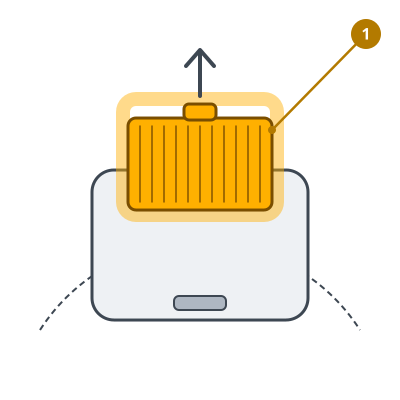
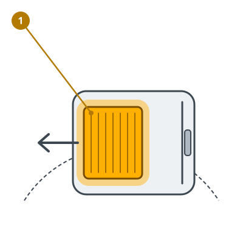
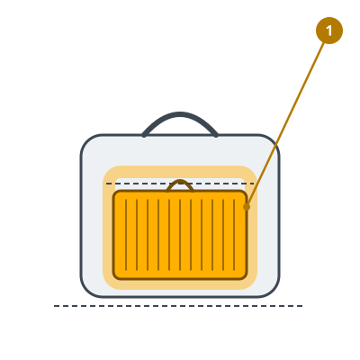

<!-- Generated by scripts/build_care_docs.py from custom_components/roomba_plus/care/. Do not edit: change the texts or drawings there and run the script. -->

# Nettoyer le filtre

[Tous les guides d'entretien](README.md)

## Roomba séries 600 et 700

**À quoi ça sert**

Le filtre retient la poussière fine dans le bac. Quand ses plis sont colmatés, l'aspiration baisse et le robot ramasse moins.

**Comment faire**

1. Appuyez sur le bouton de déverrouillage du bac et sortez le bac du robot.
2. Libérez le filtre en appuyant dessus, puis soulevez-le.
3. Tapotez-le contre l'intérieur d'une poubelle jusqu'à ce qu'il ne tombe plus de poussière. Ne brossez pas les plis.
4. Remettez le filtre et insérez le bac jusqu'au déclic.

> **Attention** Ne lavez jamais un filtre en papier et ne le laissez pas se mouiller : une fois mouillé, il ne filtre plus.

## Roomba séries 800 et 900

**À quoi ça sert**

Le filtre retient la poussière fine dans le bac. Quand ses plis sont colmatés, l'aspiration baisse et le robot ramasse moins.

**Comment faire**

1. Appuyez sur le bouton de déverrouillage du bac, sortez le bac et videz-le.
2. Appuyez sur la languette de la trappe du filtre et soulevez la trappe.
3. Tirez le filtre par sa languette jaune et tapotez-le contre l'intérieur d'une poubelle jusqu'à ce qu'il ne tombe plus de poussière.
4. Remettez le filtre, fermez la trappe et insérez le bac jusqu'au déclic.

> **Attention** Ne lavez jamais un filtre en papier et ne le laissez pas se mouiller : une fois mouillé, il ne filtre plus.

## Roomba séries e, i et j, Combo j

**À quoi ça sert**

Le filtre retient la poussière fine dans le bac. Quand ses plis sont colmatés, l'aspiration baisse et le robot ramasse moins.

**Comment faire**

1. Appuyez sur le bouton de déverrouillage du bac à l'arrière du robot et sortez le bac.
2. Ouvrez la porte du bac au-dessus d'une poubelle et videz-le.
3. Saisissez le filtre par les côtés, tirez-le vers la gauche et tapotez-le contre l'intérieur de la poubelle jusqu'à ce qu'il ne tombe plus de poussière.
4. Remettez le filtre et glissez le bac dans son guide jusqu'au déclic.

> **Attention** Ne lavez jamais un filtre en papier et ne le laissez pas se mouiller : une fois mouillé, il ne filtre plus.

## Roomba série s

**À quoi ça sert**

Le filtre retient la poussière fine dans le bac. Quand ses plis sont colmatés, l'aspiration baisse et le robot ramasse moins.

**Comment faire**

1. Appuyez sur le bouton du couvercle, ouvrez-le et sortez le bac par sa poignée.
2. Tenez le bac au-dessus d'une poubelle et appuyez sur son bouton pour le vider.
3. Ouvrez la trappe du filtre, tirez le filtre par sa boucle et tapotez-le contre l'intérieur de la poubelle.
4. Remettez le filtre et fermez la trappe : elle ne ferme qu'avec un filtre bien en place. Remettez le bac.

> **Attention** Ne lavez jamais un filtre en papier et ne le laissez pas se mouiller : une fois mouillé, il ne filtre plus.

## Robots Prime et autres modèles

**À quoi ça sert**

Le filtre retient la poussière fine dans le bac. Quand ses plis sont colmatés, l'aspiration baisse et le robot ramasse moins.

**Comment faire**

1. Appuyez sur le bouton de déverrouillage du bac et sortez le bac du robot.
2. Retirez le filtre par sa languette.
3. Tapotez-le contre l'intérieur d'une poubelle jusqu'à ce qu'il ne tombe plus de poussière. Ne brossez pas les plis.
4. Remettez le filtre avec les plis dans le même sens et glissez le bac jusqu'au déclic.

> **Attention** Ne lavez jamais un filtre en papier et ne le laissez pas se mouiller : une fois mouillé, il ne filtre plus.
