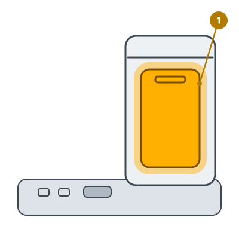

<!-- Generated by scripts/build_care_docs.py from custom_components/roomba_plus/care/. Do not edit: change the texts or drawings there and run the script. -->

# Remplacer le sac

[Tous les guides d'entretien](README.md)

**À quoi ça sert**

Le sac de la station recueille ce que le robot y vide. Quand il est plein, la station ne peut plus vider le robot.

**Comment faire**

1. Ouvrez le couvercle de la station.
2. Tirez le sac par sa languette : la languette ferme l'ouverture.
3. Insérez le nouveau sac et poussez sa carte dans le guide jusqu'à ce qu'elle tienne.
4. Fermez le couvercle et signalez le sac comme remplacé.

> **Attention** Ne réutilisez pas un sac : sa fermeture ne se ferme qu'une fois.
