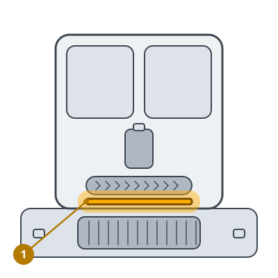

<!-- Generated by scripts/build_care_docs.py from custom_components/roomba_plus/care/. Do not edit: change the texts or drawings there and run the script. -->

# Pulisci il sistema di lavaggio del mop

[Tutte le guide di cura](README.md)

**A cosa serve**

Il sistema di lavaggio del mop a rullo raschia via l'acqua sporca. Quando le sue aperture si intasano, l'acqua sporca può gocciolare sul pavimento.

**Come fare**

1. Togli il mop a rullo dal robot.
2. Sciacqua il raschietto e le sue aperture sotto l'acqua corrente e libera i fori ostruiti con una spazzola morbida.
3. Sciacqua il mop a rullo e lascialo asciugare.
4. Rimetti il mop a rullo finché non scatta.

> **Attenzione** Nessun attrezzo appuntito sulle aperture del raschietto.
