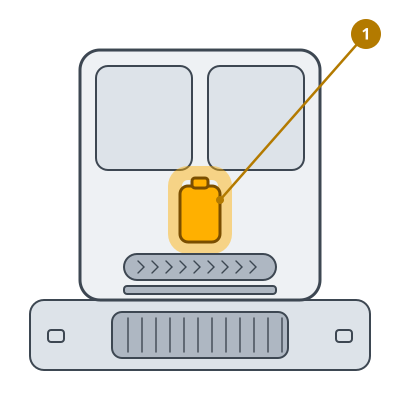

<!-- Generated by scripts/build_care_docs.py from custom_components/roomba_plus/care/. Do not edit: change the texts or drawings there and run the script. -->

# Sostituisci il detergente

[Tutte le guide di cura](README.md)

**A cosa serve**

La base aggiunge il detergente della sua cartuccia all'acqua di lavaggio. Quando è vuota, il robot lava solo con acqua.

**Come fare**

1. Apri il vano del detergente della base.
2. Estrai la cartuccia vuota.
3. Inserisci quella nuova finché non è ferma e chiudi il vano.
4. Segnala il detergente come sostituito.

> **Attenzione** Usa solo detergente per questa base: altri prodotti possono fare schiuma o danneggiarla.
