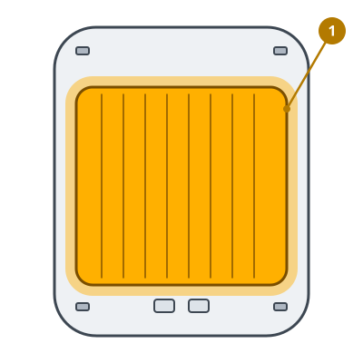

<!-- Generated by scripts/build_care_docs.py from custom_components/roomba_plus/care/. Do not edit: change the texts or drawings there and run the script. -->

# Sostituisci il panno

[Tutte le guide di cura](README.md)

## Roomba serie e, i e j, Combo j · Robot Prime e altri modelli

**A cosa serve**

Un panno consumato lascia aloni e raccoglie meno sporco.

**Come fare**

1. Solleva il robot o toglilo dalla base.
2. Sfila il vecchio panno dal supporto.
3. Fai scorrere o premi il panno nuovo sul supporto finché non è fermo.
4. Segnala il panno come sostituito.

> **Attenzione** Lava i panni lavabili senza ammorbidente; usa quelli monouso una volta sola.

## Braava jet

**A cosa serve**

Un panno consumato lascia aloni e raccoglie meno sporco.

**Come fare**

1. Solleva il robot o toglilo dalla base.
2. Sfila il vecchio panno dal supporto.
3. Fai scorrere o premi il panno nuovo sul supporto finché non è fermo.
4. Segnala il panno come sostituito.

> **Attenzione** Lava i panni lavabili senza ammorbidente; usa quelli monouso una volta sola.
