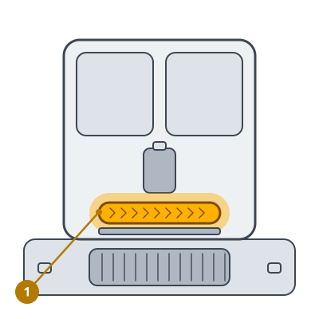

<!-- Generated by scripts/build_care_docs.py from custom_components/roomba_plus/care/. Do not edit: change the texts or drawings there and run the script. -->

# Sostituisci il mop a rullo

[Tutte le guide di cura](README.md)

**A cosa serve**

Un mop a rullo consumato non preme più in modo uniforme sul pavimento e lascia aloni.

**Come fare**

1. Togli il mop a rullo dal robot.
2. Inserisci quello nuovo finché non scatta da entrambi i lati.
3. Segnala il mop a rullo come sostituito.

> **Attenzione** Lascia asciugare un mop lavato prima di rimetterlo.
