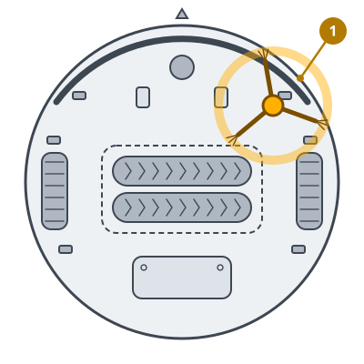
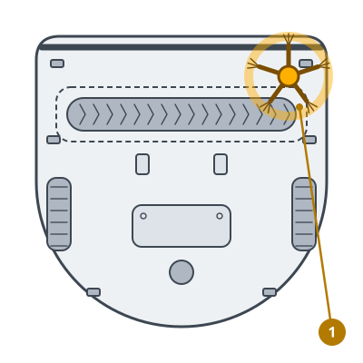

<!-- Generated by scripts/build_care_docs.py from custom_components/roomba_plus/care/. Do not edit: change the texts or drawings there and run the script. -->

# Zijborstel vervangen

[Alle verzorgingshandleidingen](README.md)

## Roomba 600- en 700-serie · Roomba 800- en 900-serie

**Waarvoor**

Een versleten zijborstel komt niet meer in randen en hoeken.

**Zo doe je het**

1. Leg de robot ondersteboven.
2. Draai de schroef los of trek de oude borstel van de as.
3. Druk de nieuwe borstel op de as en maak hem vast.
4. Meld de zijborstel als vervangen.

> **Let op** Bewaar de schroef: een losse borstel valt eraf tijdens het reinigen.

## Roomba e-, i- en j-serie, Combo j · Prime-robots en andere modellen

**Waarvoor**

Een versleten zijborstel komt niet meer in randen en hoeken.

**Zo doe je het**

1. Leg de robot ondersteboven.
2. Draai de schroef los of trek de oude borstel van de as.
3. Druk de nieuwe borstel op de as en maak hem vast.
4. Meld de zijborstel als vervangen.

> **Let op** Bewaar de schroef: een losse borstel valt eraf tijdens het reinigen.

## Roomba s-serie

**Waarvoor**

Een versleten hoekborstel komt niet meer in de hoeken.

**Zo doe je het**

1. Leg de robot ondersteboven.
2. Draai de schroef los en neem de oude hoekborstel eraf.
3. Zet de nieuwe hoekborstel op de pen en draai de schroef vast.
4. Meld de hoekborstel als vervangen.

> **Let op** Bewaar de schroef: een losse borstel valt eraf tijdens het reinigen.
