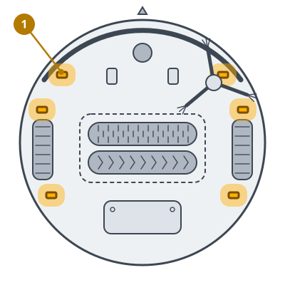
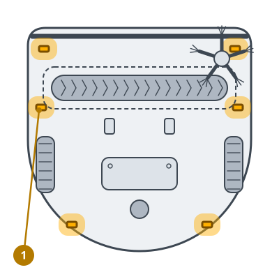
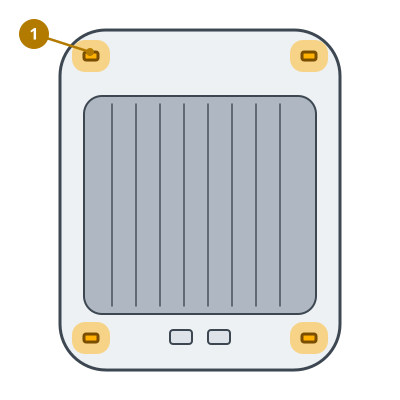

<!-- Generated by scripts/build_care_docs.py from custom_components/roomba_plus/care/. Do not edit: change the texts or drawings there and run the script. -->

# Wyczyść czujniki krawędzi

[Wszystkie instrukcje pielęgnacji](README.md)

## Roomba serii 600 i 700 · Roomba serii 800 i 900

**Do czego służy**

Czujniki krawędzi patrzą w dół w poszukiwaniu schodów i uskoków. Kurz na ich okienkach może zatrzymać robota albo sprawić, że przeoczy krawędź.

**Jak to zrobić**

1. Odwróć robota.
2. Przetrzyj każde okienko czujnika lekko wilgotną gąbką melaminową lub ściereczką.
3. Sprawdź, czy żadne okienko nie jest porysowane ani zakryte.

> **Uwaga** Nigdy nie pryskaj środkiem czyszczącym na czujniki ani do ich otworów.

## Roomba serii e, i oraz j, Combo j · Roboty Prime i inne modele

**Do czego służy**

Czujniki krawędzi patrzą w dół w poszukiwaniu schodów i uskoków. Kurz na ich okienkach może zatrzymać robota albo sprawić, że przeoczy krawędź.

**Jak to zrobić**

1. Odwróć robota.
2. Przetrzyj każde okienko czujnika lekko wilgotną gąbką melaminową lub ściereczką.
3. Sprawdź, czy żadne okienko nie jest porysowane ani zakryte.

> **Uwaga** Nigdy nie pryskaj środkiem czyszczącym na czujniki ani do ich otworów.

## Roomba serii s

**Do czego służy**

Czujniki krawędzi patrzą w dół w poszukiwaniu schodów i uskoków. Kurz na ich okienkach może zatrzymać robota albo sprawić, że przeoczy krawędź.

**Jak to zrobić**

1. Odwróć robota.
2. Przetrzyj każde okienko czujnika lekko wilgotną gąbką melaminową lub ściereczką.
3. Sprawdź, czy żadne okienko nie jest porysowane ani zakryte.

> **Uwaga** Nigdy nie pryskaj środkiem czyszczącym na czujniki ani do ich otworów.

## Braava jet

**Do czego służy**

Czujniki krawędzi patrzą w dół w poszukiwaniu schodów i uskoków. Kurz na ich okienkach może zatrzymać robota albo sprawić, że przeoczy krawędź.

**Jak to zrobić**

1. Odwróć robota.
2. Przetrzyj każde okienko czujnika lekko wilgotną gąbką melaminową lub ściereczką.
3. Sprawdź, czy żadne okienko nie jest porysowane ani zakryte.

> **Uwaga** Nigdy nie pryskaj środkiem czyszczącym na czujniki ani do ich otworów.
