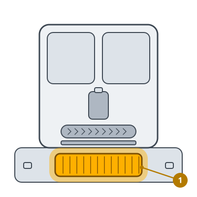

<!-- Generated by scripts/build_care_docs.py from custom_components/roomba_plus/care/. Do not edit: change the texts or drawings there and run the script. -->

# Wyczyść system mycia stacji

[Wszystkie instrukcje pielęgnacji](README.md)

**Do czego służy**

System mycia stacji wypłukuje brud z mopa. Jeśli zostają w nim resztki, mop wychodzi brudny.

**Jak to zrobić**

1. Wyjmij wkład myjący ze stacji.
2. Wypłucz go pod bieżącą wodą i usuń włosy i zanieczyszczenia z otworów.
3. Przetrzyj miejsce wkładu w stacji.
4. Włóż wkład tak, aby leżał płasko.

> **Uwaga** Bez środków czyszczących, chyba że instrukcja stacji na to pozwala.
