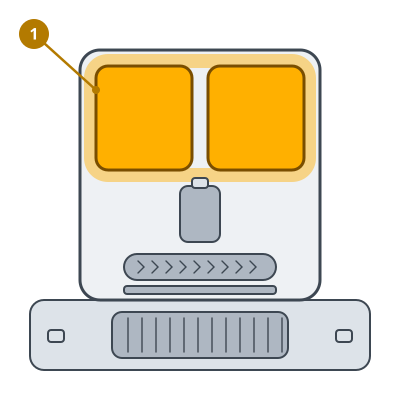

<!-- Generated by scripts/build_care_docs.py from custom_components/roomba_plus/care/. Do not edit: change the texts or drawings there and run the script. -->

# Wyczyść stację myjącą

[Wszystkie instrukcje pielęgnacji](README.md)

**Do czego służy**

Stacja myjąca płucze mop. Brud w jej tacce lub pełny zbiornik brudnej wody zatrzymuje mycie.

**Jak to zrobić**

1. Wyjmij zbiornik brudnej wody, opróżnij go i wypłucz.
2. Wyjmij tackę myjącą i wypłucz ją pod bieżącą wodą.
3. Wytrzyj do sucha dno stacji i włóż tackę i zbiornik z powrotem.
4. Napełnij zbiornik czystej wody, jeśli jest prawie pusty.

> **Uwaga** Pozwól tacce wyschnąć, zanim robot znów na nią wjedzie.
