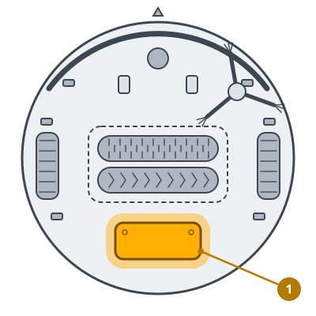
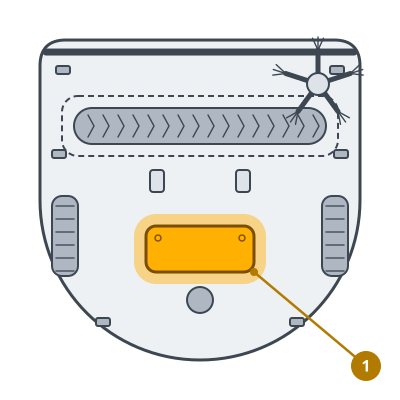

<!-- Generated by scripts/build_care_docs.py from custom_components/roomba_plus/care/. Do not edit: change the texts or drawings there and run the script. -->

# Wymień akumulator

[Wszystkie instrukcje pielęgnacji](README.md)

## Roomba serii 600 i 700 · Roomba serii 800 i 900

**Do czego służy**

Akumulator z każdym ładowaniem traci pojemność. Robot pracuje wtedy krócej i może się zatrzymać, zanim skończy.

**Jak to zrobić**

1. Wyłącz robota i odwróć go.
2. Odkręć śruby pokrywy akumulatora i zdejmij ją.
3. Wyciągnij stary akumulator za uchwyty i włóż nowy stykami w tę samą stronę.
4. Załóż pokrywę, postaw robota na stacji i zgłoś akumulator jako wymieniony.

> **Uwaga** Używaj akumulatora do tego modelu, a stary oddaj do punktu zbiórki baterii.

## Roomba serii e, i oraz j, Combo j · Roboty Prime i inne modele

**Do czego służy**

Akumulator z każdym ładowaniem traci pojemność. Robot pracuje wtedy krócej i może się zatrzymać, zanim skończy.

**Jak to zrobić**

1. Wyłącz robota i odwróć go.
2. Odkręć śruby pokrywy akumulatora i zdejmij ją.
3. Wyciągnij stary akumulator za uchwyty i włóż nowy stykami w tę samą stronę.
4. Załóż pokrywę, postaw robota na stacji i zgłoś akumulator jako wymieniony.

> **Uwaga** Używaj akumulatora do tego modelu, a stary oddaj do punktu zbiórki baterii.

## Roomba serii s

**Do czego służy**

Akumulator z każdym ładowaniem traci pojemność. Robot pracuje wtedy krócej i może się zatrzymać, zanim skończy.

**Jak to zrobić**

1. Wyłącz robota i odwróć go.
2. Odkręć śruby pokrywy akumulatora i zdejmij ją.
3. Wyciągnij stary akumulator za uchwyty i włóż nowy stykami w tę samą stronę.
4. Załóż pokrywę, postaw robota na stacji i zgłoś akumulator jako wymieniony.

> **Uwaga** Używaj akumulatora do tego modelu, a stary oddaj do punktu zbiórki baterii.

## Braava jet

**Do czego służy**

Akumulator z każdym ładowaniem traci pojemność. Robot pracuje wtedy krócej i może się zatrzymać, zanim skończy.

**Jak to zrobić**

1. Wyłącz robota i odwróć go.
2. Odkręć śruby pokrywy akumulatora i zdejmij ją.
3. Wyciągnij stary akumulator za uchwyty i włóż nowy stykami w tę samą stronę.
4. Załóż pokrywę, postaw robota na stacji i zgłoś akumulator jako wymieniony.

> **Uwaga** Używaj akumulatora do tego modelu, a stary oddaj do punktu zbiórki baterii.
