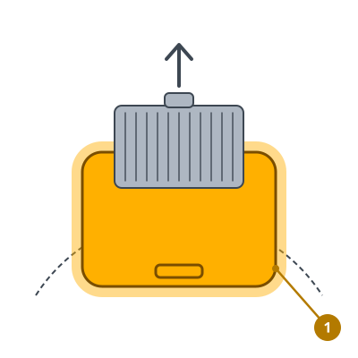
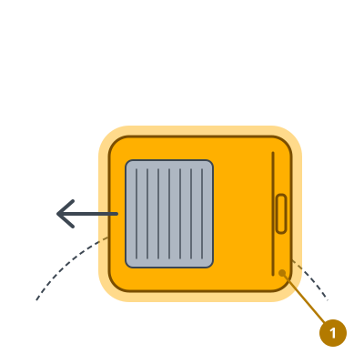
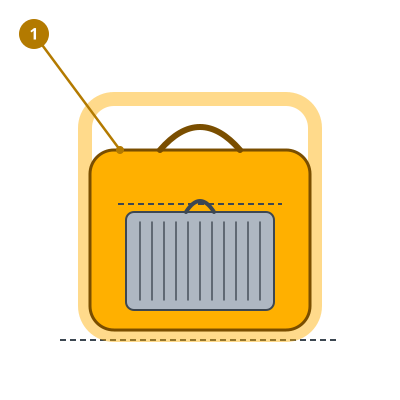

<!-- Generated by scripts/build_care_docs.py from custom_components/roomba_plus/care/. Do not edit: change the texts or drawings there and run the script. -->

# Esvaziar e verificar o depósito

[Todos os guias de cuidados](README.md)

## Roomba séries 600 e 700 · Roomba séries 800 e 900

**Para que serve**

O depósito guarda o que o robô apanha. Um depósito cheio ou mal encaixado não o deixa apanhar mais.

**Como fazer**

1. Prima o botão de libertação e retire o depósito.
2. Abra a tampa sobre o caixote do lixo e esvazie o depósito.
3. Retire o filtro, bata-o e tire o pó do seu alojamento.
4. Volte a pôr o filtro e encaixe o depósito até ouvir um clique.

> **Atenção** Enxague apenas um depósito feito para isso, sem o filtro, e deixe-o secar completamente antes de o colocar.

## Roomba séries e, i e j, Combo j

**Para que serve**

O depósito guarda o que o robô apanha. Um depósito cheio ou mal encaixado não o deixa apanhar mais.

**Como fazer**

1. Prima o botão de libertação do depósito na traseira do robô e retire o depósito.
2. Abra a porta do depósito sobre o caixote do lixo e esvazie-o.
3. Retire o filtro e bata-o. Se o depósito estiver sujo, enxague-o à mão com água morna.
4. Deixe o depósito secar completamente, volte a colocar o filtro e encaixe o depósito até ouvir um clique.

> **Atenção** Enxague só à mão, nunca na máquina de lavar loiça e nunca com o filtro colocado.

## Roomba série s

**Para que serve**

O depósito guarda o que o robô apanha. Um depósito cheio ou mal encaixado não o deixa apanhar mais.

**Como fazer**

1. Prima o botão da tampa e levante o depósito pela pega.
2. Segure o depósito sobre o caixote do lixo e prima o botão dele para o esvaziar.
3. Retire o filtro e bata-o. Se o depósito estiver sujo, enxague-o com água morna.
4. Deixe o depósito secar completamente, volte a colocar o filtro e o depósito no robô.

> **Atenção** Enxague só à mão, nunca na máquina de lavar loiça e nunca com o filtro colocado.

## Robôs Prime e outros modelos

**Para que serve**

O depósito guarda o que o robô apanha. Um depósito cheio ou mal encaixado não o deixa apanhar mais.

**Como fazer**

1. Prima o botão de libertação e retire o depósito.
2. Abra a tampa sobre o caixote do lixo e esvazie o depósito.
3. Retire o filtro, bata-o e tire o pó do seu alojamento.
4. Volte a pôr o filtro e encaixe o depósito até ouvir um clique.

> **Atenção** Enxague apenas um depósito feito para isso, sem o filtro, e deixe-o secar completamente antes de o colocar.
